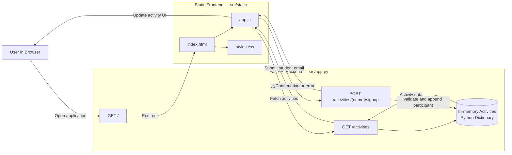

# Getting Started with GitHub Copilot

Hey MS-stev-van!

Mona here. I'm done preparing your exercise. Hope you enjoy! 💚

Remember, it's self-paced so feel free to take a break! ☕️

## Application architecture

The browser loads a plain HTML, CSS, and JavaScript interface. The JavaScript calls the FastAPI endpoints, which read or update an in-memory Python dictionary. Restarting the server resets all signup data.

---

&copy; 2025 GitHub &bull; [Code of Conduct](https://www.contributor-covenant.org/version/2/1/code_of_conduct/code_of_conduct.md) &bull; [MIT License](https://gh.io/mit)
